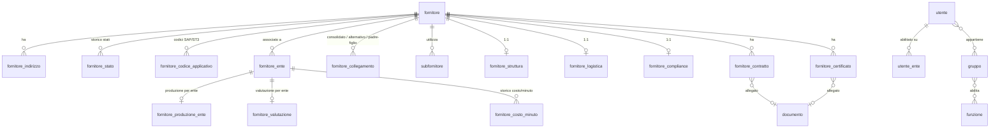

# Albo Fornitori — Database PostgreSQL

Schema progettato a partire dall'analisi tecnico-funzionale e dalla specifica logica del sistema legacy (ASP.NET Web Forms + SQL Server). Le migrazioni sono SQL puro, quindi indipendenti dallo strumento (node-pg-migrate, dbmate, Flyway…). Richiede **PostgreSQL ≥ 15**; lo schema è verificato su 16.

## Applicazione

```bash
createdb albo
for f in db/migrations/0*.sql; do psql -d albo -v ON_ERROR_STOP=1 -f "$f"; done
```

| File | Contenuto |
| --- | --- |
| `001_common.sql` | Estensioni (`pg_trgm`, `unaccent`), schemi, trigger `updated_at`, template delle lookup |
| `002_ref.sql` | Lookup e geografia (nazione → regione → provincia → località) |
| `003_iam.sql` | Utenti, gruppi, funzioni/menu con traduzioni, visibilità sugli enti |
| `004_albo.sql` | Dominio fornitore: anagrafica, società, economia, produzione, logistica, contratti, compliance, valutazioni |
| `005_ext_audit.sql` | Dati importati da SAP/ST3/ERP (sola lettura) e log applicativo |
| `006_views.sql` | Viste che sostituiscono le principali `VIEW_*` legacy |

## Schemi

| Schema | Ruolo | Sostituisce |
| --- | --- | --- |
| `ref` | Liste di valori, geografia, enti, società, marchi | `OCA.ANAGRAFICA.TIPO_*`, `NAZIONE`, `LOCALITA`, `TBL_Province`… |
| `iam` | Identità e autorizzazioni | `VIEW_UTENZE_GSR`, `TB_GSR_UTENZE`, `TBL_GruppiUtenti`, `VIEW_AbilitazioniFunzioni` |
| `albo` | Dati gestiti dall'applicazione | `TB_FORNITORE_*`, `OCA.ANAGRAFICA.FORNITORE*` |
| `ext` | Dati alimentati da ETL, mai scritti dall'app | `FORNITORE_ORDINATO_SAP/ST3`, `FATTURATO_*`, `MOD_PAGAMENTO` |
| `audit` | Log append-only | `TBL_TRACELOG` |

## Modello principale



## Convenzioni

- **Nomi in italiano, snake_case**, coerenti con il dominio e con i nomi legacy per facilitare la mappatura.
- **ID legacy conservati.** Le identity sono `GENERATED BY DEFAULT`: si importano gli ID originali e poi si riallinea la sequenza con `setval`.
- **Tracciamento.** Tutte le tabelle modificabili hanno `created_at/created_by/updated_at/updated_by`; `updated_at` è gestito da trigger.
- **Lookup uniformi.** Tutte le lookup nascono da `common.lookup_template` (`id, codice, descrizione_it, descrizione_en, ordine, attivo`). L'API può servirle con un solo endpoint generico e la UI ha già le due lingue.
- **Dati per ente.** Produzione, classi merceologiche, costo/minuto e valutazioni hanno una FK composta verso `fornitore_ente`: il DB impedisce dati per un ente non associato al fornitore.
- **Nessuna FK nell'audit**, così il log sopravvive alle modifiche dei dati.
- **Allegati fuori dal DB.** `albo.documento` contiene solo metadati, hash e `storage_key`; i file vanno su file system o object storage.
- **Relazioni simmetriche in forma canonica.** I collegamenti PADRE_FIGLIO sono salvati con l'id minore in `fornitore_da_id` (lo fa un trigger). Nella migrazione dei dati, se il legacy contiene sia A→B sia B→A, la seconda riga va scartata (`ON CONFLICT DO NOTHING`).
- **Autorizzazione nell'API.** Il filtro per enti autorizzati è applicato dal backend usando `iam.v_utente_ente_fornitore`. La Row-Level Security di PostgreSQL resta un'opzione futura.

## Differenze volute rispetto al legacy

| Legacy | Nuovo modello | Motivo |
| --- | --- | --- |
| `Session("IDFornitore")` | Fornitore nell'URL (`/fornitori/:id/...`) | API stateless, link condivisibili |
| Windows Authentication | `iam.utente.oidc_subject` + username normalizzato | Login OIDC; `username` permette di agganciare gli utenti esistenti |
| SQL dinamico concatenato | Indici dedicati alla ricerca (trigram, accent-insensitive) | Query parametrizzate e performanti |
| Geocoding a runtime | Coordinate salvate in `fornitore_indirizzo` | Mappa senza chiamate esterne ad ogni apertura |
| `REFERENCE` come tipo di collegamento | Lettura inversa di `ALTERNATIVO` (vista `v_fornitore_collegamento`) | "Fornitore alternativo di" è la stessa relazione vista dall'altro lato |
| Dati HR della persona (nascita, sesso, CF, assunzione) | Non migrati | Non servono all'Albo (minimizzazione dei dati personali) |

## Ipotesi da verificare

Le ipotesi sono marcate `[H#]` nei commenti SQL e sono visibili anche nel catalogo (`\d+`). Ciascuna si chiude confrontando lo schema con il DDL legacy o con un campione di dati.

| # | Ipotesi | Dove |
| --- | --- | --- |
| H1 | `nazione.europa` identifica la lista "Trasporti internazionali Europa" | `ref.nazione` |
| H2 | Struttura di marchio/divisione | `ref.divisione`, `albo.fornitore_marchio` |
| H3 | ✅ Confermata: superfici, costi e numero addetti della logistica sono valori numerici liberi | `albo.fornitore_logistica` |
| H4 | Gli indicatori di compliance usano una lista comune di esiti | `ref.esito_compliance` |
| H5 | I punteggi di valutazione hanno una scala configurabile | `ref.punteggio_valutazione` |
| H6 | Le funzioni si assegnano solo tramite gruppo, mai direttamente all'utente | `iam.gruppo_funzione` |
| H7 | ✅ Confermata: i dati master (P.IVA, CF, telefono, IBAN) appartengono all'ERP e restano in sola lettura | `albo.fornitore.fonte_master` |
| H8 | `COD_RESPONSABILE` è un codice persona non ancora riconciliato con gli utenti | `albo.fornitore` |
| H9 | Regola dell'indirizzo principale | `albo.fornitore_indirizzo.principale` |
| H10 | Il capitale versato è un dato master | `albo.fornitore_struttura` |
| H11 | Un subfornitore può coincidere con un fornitore dell'albo | `albo.subfornitore.fornitore_albo_id` |
| H12 | ✅ Confermata: CONSOLIDATO va da capogruppo a consolidato; PADRE_FIGLIO è simmetrico (stessa azienda nel tempo) | `albo.fornitore_collegamento`, viste del fatturato |
| H13 | L'affidamento è per anno | `albo.fornitore_affidamento` |
| H14 | Tempi di consegna e capacità produttiva restano testo libero | tabelle di produzione |
| H15 | I flag del façon RTW sono booleani | `albo.fornitore_facon_rtw` |
| H16 | Rimuovere un ente con dati dipendenti richiede conferma esplicita | FK verso `albo.fornitore_ente` |
| H17 | Il fatturato attivo ha la stessa struttura del passivo | `ext.fatturato_attivo` |
| H18 | Il consolidato somma un solo livello (capogruppo + consolidati diretti) | `ext.v_fatturato_passivo_consolidato` |

## Mappatura delle classi legacy

| Classe legacy | Tabelle |
| --- | --- |
| `clsPradaSupplier` | `fornitore`, `fornitore_stato`, `fornitore_ente`, `fornitore_preferito`, `fornitore_collegamento`, `fornitore_marchio`, `fornitore_codice_applicativo` |
| `clsPradaSupplierAddress` | `fornitore_indirizzo` |
| `clsPradaSupplierAsset` | `fornitore_struttura` |
| `clsPradaSupplierContact` | `fornitore_interlocutore` |
| `clsPradaSupplierSub` | `subfornitore` |
| `clsPradaSupplierEconomics` | `fornitore_dati_economici`, `fornitore_affidamento` |
| `clsPradaSupplierProduction` | `fornitore_produzione_ente`, `fornitore_classe_merceologica`, `fornitore_sottoclasse_merceologica`, `fornitore_costo_minuto` |
| `clsPradaSupplierMPAcceRTW / LG / FootWear` | `fornitore_mp_rtw`, `fornitore_mp_pelletteria`, `fornitore_mp_calzature` |
| `clsPradaSupplierServProdRTW / LG` | `fornitore_facon_rtw`, `fornitore_facon_pelletteria` |
| `clsPradaSupplierEquipment` | `fornitore_macchina` |
| `clsPradaSupplierLogistics` | `fornitore_logistica` + 5 tabelle `fornitore_logistica_*` |
| `clsPradaSupplierContract` | `fornitore_contratto`, `documento` |
| `clsPradaSupplierDocument` | `fornitore_certificato`, `documento` |
| `clsPradaSupplierCompliance` | `fornitore_compliance` |
| `clsPradaSupplierValutation` | `fornitore_valutazione` |
| `clsPradaSupplierUser` | `iam.utente`, `iam.utente_gruppo`, `iam.utente_ente` |
